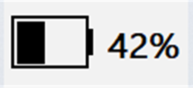

# razer-battery-stats

A battery panel for the Windows 10 classic taskbar that shows your Razer mouse's
charge level. It talks to the mouse over HID directly — **Razer Synapse is not
required and need not be running**.

[](https://github.com/Kreedzt/razer-battery-stats/actions/workflows/release.yml)
[](https://github.com/Kreedzt/razer-battery-stats/releases/latest)




*The panel sits in the taskbar strip, immediately left of the notification area.*

## What it does

- Lives in the taskbar strip, immediately left of the notification area,
  showing a battery glyph plus a percentage (`--%` when there is no reading).
- Hover for the model, charge level, charging state, the connection actually
  used (wired, wireless receiver, or Bluetooth) and how fresh the reading is.
  A bolt is drawn only when the mouse reports charging; a cable is shown as
  `Wired` but never treated as proof of charging.
- Polls every 30 s, every 10 s while charging, and backs off to 60 s after a
  failed read (asleep, unplugged) so it never keeps the mouse awake.
- Keeps drawing while the Start menu or search is open, follows taskbar
  auto-hide, and rebuilds itself after an Explorer restart.
- Right-click for **Refresh now**, **Start with Windows**, and **Exit**.
- Restores the taskbar layout on exit; single-instance guarded.

## Requirements

- Windows 10 (classic taskbar). Windows 11 is not supported — the taskbar there
  is a different window hierarchy.
- A Razer mouse supported by [`razer-hid`](https://github.com/xzeldon/razer-battery-report).
  Verified on the DeathAdder V3 Pro; other models are untested.

## Build

```
cargo build --release
```

Output: `target/release/razer-battery-taskbar.exe`.

The binary carries a `VERSIONINFO` resource compiled by the Windows SDK's
`rc.exe`. Without the SDK the build still succeeds (with a warning) and simply
ships no version metadata; set `RC=/path/to/rc.exe` to point at a specific one.

## Run

Launch the executable. There is no installer and no service: it is a single
user-level process with no driver and no elevation.

To start it with Windows, right-click the panel and tick **Start with Windows**
(per-user `HKCU\...\Run` entry, removable from the same menu). To stop it,
right-click and choose **Exit**, which also restores the taskbar.

## Design notes

The panel is a child window of Explorer's taskbar rebar, created with
`WS_EX_LAYERED` and given an explicit alpha. That is the only configuration that
survives the Start menu: a topmost popup is dropped from DWM composition the
moment Start opens. Because a child window is destroyed together with its
parent, a separate hidden host window owned by this process recreates the panel
after an Explorer restart. See `CLAUDE.md` for the full set of constraints and
the measurements behind them.

## License

MIT — see [LICENSE](LICENSE).

## Credits

The taskbar window model — a layered child of Explorer's rebar — follows
[TrafficMonitor](https://github.com/zhongyang219/TrafficMonitor). No code was
copied from it; only the Win32 composition was reproduced, which is why this
project can stay MIT.

The Razer HID protocol, device catalog and battery queries come from
[`razer-hid`](https://github.com/xzeldon/razer-battery-report) — MIT,
Copyright (c) 2024 Timofey Gelazoniya — used here as a git dependency.

Other references:

- [openrazer protocol notes](https://github.com/openrazer/openrazer/wiki/Reverse-Engineering-USB-Protocol)
- Microsoft Win32 documentation for `SetParent`, `ReBarWindow32`,
  `WS_EX_LAYERED` and `VERSIONINFO`
